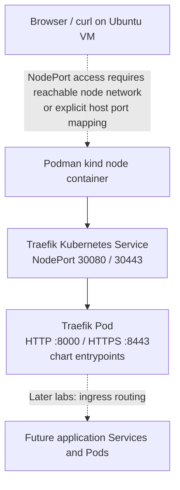
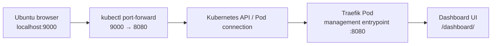
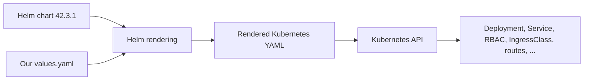
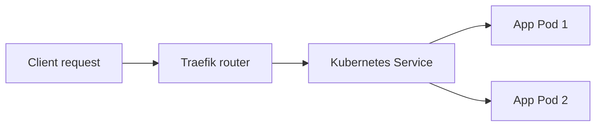

# Lab 01 — Install Traefik on Kubernetes (kind + Podman)

> **Project:** `DevOps / 14-Web-Servers / 02-traefic`  
> **Goal:** Install Traefik as a Kubernetes ingress controller using Helm, expose HTTP/HTTPS entrypoints, and access the Traefik dashboard securely through a local port-forward.  
> **Status:** ✅ Traefik dashboard accessible. Application routing, TLS certificates, and external Nexus integration are **not yet implemented**.

## 1. Learning objectives

By completing this lab, we learn to:

- Identify Traefik's role as a **reverse proxy**, **load balancer**, and **Kubernetes ingress controller**.
- Understand how **Helm charts**, `values.yaml`, and rendered Kubernetes manifests relate to each other.
- Deploy Traefik into a dedicated Kubernetes namespace.
- Use a `NodePort` Service for the lab's HTTP and HTTPS entrypoints.
- Enable the dashboard **without exposing its administrative API publicly**.
- Inspect generated Kubernetes resources, troubleshoot Helm schema changes, and verify the deployment.

## 2. Lab environment

These details were observed during the lab, not assumed:

| Component | Observed value |
|---|---|
| Host | Ubuntu VM (`behroox01-virtualbox`) |
| Kubernetes distribution | **kind**, with **Podman** on the host |
| Current context | `kind-kind-first-cluster` |
| Node | `kind-first-cluster-control-plane` — `Ready` |
| Kubernetes | `v1.37.0` |
| Node OS | Debian GNU/Linux 13 (trixie) |
| Node container runtime | containerd `2.3.4` |
| Helm CLI | `v4.3.0` |
| Traefik Helm chart | `42.3.1` |
| Traefik application | `v3.7.17` |
| Pre-existing IngressClass | None at the time of inspection |

**Important:** Podman runs the kind *node container*; Kubernetes inside that node uses **containerd** to run Pods. These are different layers and are not contradictory.

## 3. Architecture and traffic flows

### 3.1 Overall layout



`30080` and `30443` are **Kubernetes NodePorts**, not automatically equivalent to `localhost:30080` and `localhost:30443` on the Ubuntu host. Because kind runs inside Podman, host reachability depends on the networking configuration. **We have not verified external NodePort access in this lab.**

### 3.2 Dashboard access (what we actually tested)



The port-forward binds to local loopback by default. This is a convenient **lab-only access path** and avoids exposing the management interface through the public NodePort Service.

### 3.3 Configuration pipeline



- **Chart:** A versioned package of Kubernetes templates and defaults.
- **`values.yaml`:** Our selected configuration overrides.
- **`helm template`:** Generates YAML locally without deploying.
- **`helm install`:** Creates release-managed resources in the cluster.
- **`helm upgrade`:** Applies subsequent configuration changes.

## 4. Preflight checks (read-only)

Before changing the cluster, we ran:

```bash
helm version --short
helm list -A
kubectl config current-context
kubectl get nodes -o wide
kubectl get ingressclass
```

Observed highlights:

```text
Helm: v4.3.0+gbec5b06
Context: kind-kind-first-cluster
Node: kind-first-cluster-control-plane   Ready   v1.37.0
IngressClass: No resources found
```

`helm list -A` initially displayed no Helm releases. This confirmed that no existing releases were listed, **not** that the entire cluster was empty.

We also checked the Traefik chart repository:

```bash
helm repo list
helm search repo traefik/traefik
```

The repository was already configured. If it is missing on another machine:

```bash
helm repo add traefik https://traefik.github.io/charts
helm repo update
```

Among the search results:

```text
traefik/traefik       Chart 42.3.1   App v3.7.17
traefik/traefik-crds  Chart 1.18.0
```

We used **`traefik/traefik`**, the Traefik proxy/controller chart, not Traefik Hub, Mesh, or Enterprise.

## 5. Create the lab directory

Our repository path:

```bash
cd ~/DevOps/dev-ops/14-Web-Servers
mkdir -p 02-traefic
cd 02-traefic
```

> **Naming note:** The product is spelled **Traefik** (not *Traefic*). The existing `02-traefic` directory works fine; renaming it later is optional.

## 6. Write `values.yaml`

Create the file:

```bash
nano values.yaml
```

Use the configuration that passed Helm rendering in this lab:

```yaml
# Lab 01 — Traefik with HTTP/HTTPS NodePorts and a locally accessed dashboard
# Chart version: 42.3.1

deployment:
  replicas: 1

service:
  spec:
    type: NodePort

ports:
  web:
    nodePort: 30080
  websecure:
    nodePort: 30443

api:
  dashboard: true
  insecure: false

ingressRoute:
  dashboard:
    enabled: true
    entryPoints:
      - traefik
    matchRule: "PathPrefix(`/dashboard`) || PathPrefix(`/api`)"

providers:
  kubernetesIngress:
    enabled: true
  kubernetesCRD:
    enabled: true
```

### What each choice means

| Key | Purpose | Why in this lab? |
|---|---|---|
| `deployment.replicas: 1` | Runs one Traefik Pod | Small kind cluster; HA comes later |
| `service.spec.type: NodePort` | Creates a node-exposed Service | Kind doesn't provide a cloud LoadBalancer by default |
| `ports.web.nodePort: 30080` | Assigns HTTP NodePort | Predictable test port |
| `ports.websecure.nodePort: 30443` | Assigns HTTPS NodePort | Reserve HTTPS entrypoint for later TLS tests |
| `api.dashboard: true` | Turns on dashboard UI | View routers, services, and middleware |
| `api.insecure: false` | Does not enable insecure API exposure | Keeps the dashboard off an unprotected direct API listener |
| `ingressRoute.dashboard.enabled: true` | Creates a dashboard routing resource | Access dashboard via Traefik management entrypoint |
| `entryPoints: [traefik]` | Uses management entrypoint | Keeps dashboard away from `web`/`websecure` NodePorts |
| `kubernetesIngress.enabled` | Watches standard `Ingress` objects | First application-routing lab |
| `kubernetesCRD.enabled` | Watches Traefik CRDs | Future `IngressRoute` / `Middleware` labs |

**Security note:** This configuration is **for a local lab**, not a production security baseline. Do not publish the management entrypoint or forward it on `0.0.0.0` without proper authentication, access control, and network protections. An enabled API/dashboard can expose operational configuration information.

**TLS note:** Declaring an HTTPS entrypoint does **not** by itself mean we have provisioned a trusted certificate for a domain. Certificate management and testing come later.

## 7. Troubleshooting: Helm chart schema changed

Our *first* attempt used:

```yaml
service:
  type: NodePort
```

Rendering failed with:

```text
Error: values don't meet the specifications of the schema(s) in the following chart(s):
traefik:
- at '/service': additional properties 'type' not allowed
```

**Cause:** Chart `42.3.1` does not permit `type` directly under `service`. Its schema expects the Kubernetes Service specification under `service.spec`.

**Fix:**

```yaml
service:
  spec:
    type: NodePort
```

**Lesson:** Helm chart values are **chart-version-specific**. Never assume configuration written for an older chart will validate against a newer chart. Inspect `helm show values traefik/traefik --version 42.3.1` or the chart schema when troubleshooting.

## 8. Render the manifests (no cluster changes)

```bash
helm template traefik traefik/traefik \
  --version 42.3.1 \
  --namespace traefik \
  -f values.yaml > rendered.yaml
```

This command succeeded after the schema fix.

**Why render first?** It lets us inspect the *actual* Kubernetes YAML that Helm would submit, catching mistakes before installation.

Verify the generated Service:

```bash
grep -A 30 'kind: Service$' rendered.yaml
```

From our rendered manifest:

```yaml
kind: Service
metadata:
  name: traefik
  namespace: traefik
spec:
  type: NodePort
  ports:
    - port: 80
      name: web
      targetPort: web
      protocol: TCP
      nodePort: 30080
    - port: 443
      name: websecure
      targetPort: websecure
      protocol: TCP
      nodePort: 30443
```

This is **real observed evidence** from our lab. The excerpt omits nonessential metadata and labels.

Also check for dashboard routing:

```bash
grep -A 25 'kind: IngressRoute' rendered.yaml
```

The dashboard IngressRoute should target `api@internal` with the configured rule and management entrypoint.

> **Warning:** `rendered.yaml` is a generated artifact. It is useful for reviewing and debugging, but the authoritative human-maintained configuration is `values.yaml` plus the pinned Helm chart version.

## 9. Troubleshooting: Helm 4 lint behavior

Two commands failed during our exploration:

**Attempt A**

```bash
helm lint traefik/traefik --version 42.3.1 -f values.yaml
```

Output:

```text
Error: unknown flag: --version
```

**Attempt B**

```bash
helm lint traefik/traefik -f values.yaml
```

Output:

```text
Error unable to check Chart.yaml file in chart:
stat traefik/traefik/Chart.yaml: no such file or directory
```

**Why?** `helm lint` expects a **local chart path** and does not accept the repository chart reference in the same way as `helm template`.

Use this workflow to lint exactly the chart version selected:

```bash
helm pull traefik/traefik --version 42.3.1 --untar
helm lint ./traefik -f values.yaml
```

Downloading the chart creates a local `traefik/` directory. The lint command then inspects its `Chart.yaml`, templates, and values.

**Evidence note:** We confirmed successful `helm template` output, and later confirmed the dashboard was working. The conversation does not contain a pasted successful `helm lint` output, so this document does not claim one was observed.

## 10. Install Traefik

After rendering and checking values:

```bash
helm install traefik traefik/traefik \
  --version 42.3.1 \
  --namespace traefik \
  --create-namespace \
  --values values.yaml \
  --wait \
  --timeout 5m
```

**This is a modifying operation:** It creates the `traefik` namespace if necessary and installs Kubernetes resources controlled by the Helm release. It may include a Deployment, Service, accounts, RBAC, IngressClass, and route objects, subject to chart settings.

We ultimately confirmed **the dashboard was up**, which indicates the Traefik application was running and accessible through the configured local access path. The exact Helm install output was not captured in the conversation.

Verify the installed resources:

```bash
kubectl get pods -n traefik
kubectl get svc -n traefik
kubectl get ingressclass
helm list -n traefik
```

For troubleshooting:

```bash
kubectl describe deployment traefik -n traefik
kubectl logs -n traefik deployment/traefik --tail=100
kubectl get events -n traefik --sort-by=.lastTimestamp
```

A typical healthy result includes a running Traefik Pod, a `NodePort` Service, and a Helm release shown as `deployed`. Check the actual status rather than assuming it.

## 11. Open the dashboard

Run in a terminal on the Ubuntu host:

```bash
kubectl port-forward -n traefik deployment/traefik 9000:8080
```

Leave it running. Open in your browser:

**http://localhost:9000/dashboard/**

The trailing slash after `/dashboard/` matters.

```text
Ubuntu localhost:9000  --port-forward-->  Traefik Pod :8080
                                     |
                                     +--> Dashboard /dashboard/
```

**What to inspect:**

- **EntryPoints** — Where incoming requests arrive.
- **HTTP Routers** — Rules mapping a request to a backend service.
- **HTTP Services** — Traefik's backend destinations (not the same abstraction as Kubernetes Services).
- **Middlewares** — Redirects, authentication, rate limiting, and request processing.

At this point we have a **working dashboard**, but we have not deployed our sample applications yet. Router and service lists may be sparse.

Stop the port-forward with `Ctrl+C`.

## 12. Port reference: don't confuse the layers

| Port | Where it exists | Purpose | Verified reachable from Ubuntu browser? |
|---|---|---|---|
| `30080` | Kubernetes NodePort | HTTP ingress | **Not yet tested** |
| `30443` | Kubernetes NodePort | HTTPS ingress | **Not yet tested** |
| `8080` | Traefik Pod management entrypoint | Dashboard/API routing | Via port-forward |
| `9000` | Ubuntu loopback port | Local tunnel into Traefik port 8080 | **Yes — dashboard works** |

Why **not** simply browse to `localhost:30080`? A NodePort listens on Kubernetes nodes, and the kind node is a container inside Podman. The Ubuntu-to-kind network path is different from a Kubernetes cloud node. We can configure explicit host port mappings or another supported access path in a future lab.

## 13. Change management, risks, and rollback

### What is safe and read-only?

```bash
kubectl get pods,svc -n traefik
kubectl get ingressclass
helm list -n traefik
helm template traefik traefik/traefik --version 42.3.1 -n traefik -f values.yaml
```

### What changes the system?

- `helm install`: creates workloads and supporting resources.
- `helm upgrade`: changes the installed release and may restart Pods.
- `helm uninstall`: removes release-managed objects; some CRDs, retained resources, or manually created objects can remain.

For changes to `values.yaml`, review first:

```bash
helm template traefik traefik/traefik \
  --version 42.3.1 -n traefik -f values.yaml > rendered.yaml
```

Then apply to an **already installed** release:

```bash
helm upgrade traefik traefik/traefik \
  --version 42.3.1 -n traefik -f values.yaml --wait
```

Rollback strategy:

```bash
helm history traefik -n traefik
# Only if a prior revision exists:
helm rollback traefik <REVISION_NUMBER> -n traefik
```

To completely remove the lab's Helm release:

```bash
helm uninstall traefik -n traefik
```

Do **not** use uninstall during normal experimentation if you want to preserve the running lab. Remove namespace/CRDs only after checking whether other resources depend on them.

## 14. Acceptance checklist

| Goal | State | Evidence |
|---|---|---|
| Helm installed | ✅ | `helm version --short` → `v4.3.0` |
| Kubernetes reachable | ✅ | Correct context, node `Ready` |
| Traefik repository discovered | ✅ | `helm search repo traefik/traefik` |
| Helm values schema corrected | ✅ | Successful `helm template` |
| Service rendered as `NodePort` | ✅ | `30080`, `30443` in YAML |
| Helm lint successful | ◻️ Not captured | Can verify with downloaded chart |
| Traefik dashboard accessible | ✅ | Confirmed in browser |
| Host-to-NodePort connectivity | ◻️ Not tested | Future lab |
| HTTPS certificate configured | ◻️ Not yet | Future TLS lab |
| Sample application routing | ◻️ Not yet | Next lab |
| Nexus behind Traefik | ◻️ Not yet | Optional integration lab |

## 15. What we learned

1. **Chart schema matters.** The correct `service.spec.type` location depends on the Traefik chart version.
2. **Render before deployment.** `helm template` caught our error without touching the cluster.
3. **Helm subcommands differ.** `helm lint` uses a local chart directory; `helm template` can resolve a repository chart.
4. **Ingress ports differ from dashboard ports.** The dashboard is accessed through an internal management entrypoint, tunneled to localhost.
5. **kind networking is special.** A Kubernetes NodePort inside a Podman-hosted kind cluster is not automatically reachable through the host's localhost.
6. **A functioning dashboard is a milestone, not a completed ingress gateway.** We still need to route and secure real application traffic.

## 16. Next lab — Route traffic to applications

The next hands-on milestone is:

1. Deploy a minimal HTTP application to Kubernetes.
2. Expose it using a Kubernetes `Service`.
3. Create an `Ingress` that Traefik watches.
4. Use a reliable host-to-Traefik access path (potentially `kubectl port-forward` initially).
5. Send an HTTP request with `curl` and inspect the corresponding router in the dashboard.
6. Document the expected output and a troubleshooting case.

The goal is to demonstrate the complete chain:



---

## References

- [Traefik Proxy documentation](https://doc.traefik.io/traefik/)
- [Official Traefik Helm chart](https://github.com/traefik/traefik-helm-chart)
- [Helm commands and documentation](https://helm.sh/docs/)
- [Kubernetes Services](https://kubernetes.io/docs/concepts/services-networking/service/)
- [Kubernetes Ingress](https://kubernetes.io/docs/concepts/services-networking/ingress/)
- [kind documentation](https://kind.sigs.k8s.io/)

> **Security hygiene:** Do not commit passwords, private keys, tokens, or real organizational internal addresses into a public GitHub repository. Keep sensitive configuration in secrets or private storage.
