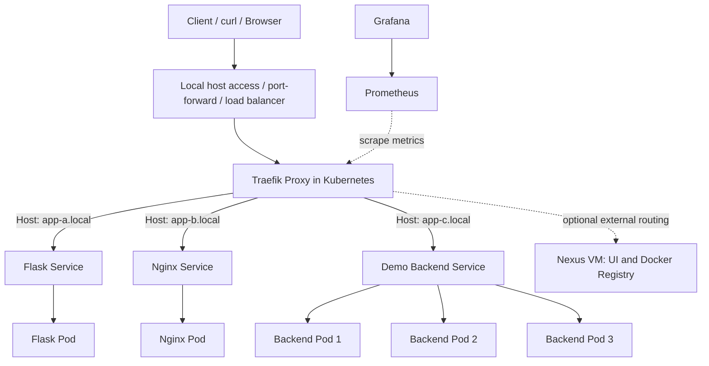

# Traefik Cloud-Native Traffic Gateway

> A hands-on DevOps portfolio project: deploy, configure, secure, observe, and troubleshoot **Traefik Proxy** as the traffic gateway for applications running in Kubernetes.

**Project status:** 🚧 Planned / in progress — do not interpret the acceptance tests below as completed work.

**Repository location (proposed):** `dev-ops/web-servers/traefik-gateway/`

## 1. Overview

The goal of this project is not merely to install an ingress controller. It is to demonstrate that I can **operate Traefik**: expose applications, define routing policies, protect traffic with TLS and middleware, load-balance multiple replicas, collect metrics, diagnose failures, and explain the architecture and trade-offs.

We'll start in an existing **kind (Kubernetes in Docker) cluster backed by Podman**, on an Ubuntu VM. The manifests and documentation should later be portable to an RKE2 or other Kubernetes environment, with environment-specific adjustments.

### Learning outcomes

By the end of the project, I should be able to:

1. Explain the roles of **reverse proxy**, **load balancer**, **Ingress controller**, and **Gateway API controller**.
2. Install and manage Traefik using **Helm**.
3. Route traffic to several Kubernetes Services by **hostname** and **path**.
4. Compare **Kubernetes Ingress**, Traefik **IngressRoute CRDs**, and the **Gateway API**.
5. Configure **TLS termination**, redirects, and certificate trust.
6. Apply Traefik **Middleware** for authentication, rate limiting, and IP restrictions.
7. Observe load balancing and behavior when replicas fail.
8. Monitor Traefik using **Prometheus**, **Grafana**, and access logs.
9. Apply baseline operational hardening and document troubleshooting.
10. Demonstrate secure routing to **Nexus hosted on an external VM** as an optional integration.

## 2. Target architecture



> **Note:** The hostnames are lab examples, not public DNS names. The exact way traffic reaches Traefik from a kind cluster depends on local container networking. A Kubernetes `LoadBalancer` Service does **not** by itself guarantee a reachable external IP in kind. We'll choose and document a working access method during the lab.

### Platform components

| Component | Role |
| --- | --- |
| kind + Podman | Local Kubernetes lab environment |
| Traefik | Entry point, reverse proxy, routing, middleware, TLS |
| Flask app | First sample backend |
| Nginx app | Second sample backend |
| Replicated demo backend | Load-balancing and failure testing |
| Prometheus | Metrics collection |
| Grafana | Metrics dashboard |
| Nexus on a separate VM (optional) | Demonstrate HTTPS proxying to an external service |

### Key Traefik concepts

| Concept | Meaning |
| --- | --- |
| **EntryPoint** | Port/listener where traffic enters Traefik, e.g. HTTP 80 or HTTPS 443 |
| **Router** | Rule that matches requests and selects a backend service |
| **Middleware** | Pre/post-routing request or response behavior: redirects, auth, rate limits, etc. |
| **Traefik Service** | Backend/load-balancing configuration used by Traefik |
| **Provider** | Source of dynamic configuration, e.g. Kubernetes Ingress, Kubernetes CRD, Gateway API, or file |
| **Kubernetes Service** | Kubernetes abstraction that exposes an application workload |

## 3. Implementation roadmap

The project is divided into small, independently demonstrable labs.

| Lab | Topic | Deliverable | Status |
| --- | --- | --- | --- |
| 00 | Baseline & preflight | Environment inventory, cluster checks | ⬜ Not started |
| 01 | Traefik installation | Helm configuration and verified running controller | ⬜ Not started |
| 02 | Basic routing | Flask/Nginx apps reachable through Ingress | ⬜ Not started |
| 03 | Advanced routing | IngressRoute and Middleware examples | ⬜ Not started |
| 04 | HTTPS | TLS Secret, HTTPS, HTTP→HTTPS redirect | ⬜ Not started |
| 05 | Load balancing | Several replicas, routing and failure tests | ⬜ Not started |
| 06 | Observability | Prometheus, Grafana, access logs | ⬜ Not started |
| 07 | Gateway API | GatewayClass, Gateway, HTTPRoute | ⬜ Not started |
| 08 | Production readiness | Security, HA design, recovery and operational checks | ⬜ Not started |
| 09 | Nexus HTTPS (optional) | Route Nexus UI and Docker registry through Traefik | ⬜ Not started |

### Lab 00 — Preflight (our immediate next action)

All commands below are **read-only**:

```bash
kubectl config current-context
kubectl get nodes -o wide
kubectl get pods -A
helm version --short
kubectl get ingressclass
kubectl get svc -A
```

Before installation, verify:

- [ ] The correct cluster/context is selected.
- [ ] Node(s) are `Ready`.
- [ ] Cluster system workloads are healthy.
- [ ] Helm is installed.
- [ ] Existing ingress controllers and port conflicts are known.
- [ ] A host-to-Traefik access strategy is selected for kind + Podman.

### Lab 01 — Install Traefik using Helm

**Reference commands — run only after preflight and checking the intended Helm chart/version and values:**

```bash
helm repo add traefik https://traefik.github.io/charts
helm repo update
helm show values traefik/traefik > traefik-default-values.yaml
kubectl create namespace traefik
helm install traefik traefik/traefik \
  --namespace traefik \
  --values deployment/helm/values.yaml
```

The project-specific `deployment/helm/values.yaml` does **not** exist yet. We'll create it during the lab, tailoring the Service type, entrypoints, providers, security settings, and access method. Do not use the install command as-is until that file is ready.

Verify:

```bash
kubectl get deployments,pods,svc -n traefik
helm list -n traefik
kubectl get ingressclass
```

Record the **chart version**, **Traefik version**, **Kubernetes version**, and applied values in the lab notes. Prefer pinning versions for reproducibility instead of relying on `latest`.

### Lab 02 — Basic routing

Deploy three backends and add routing rules:

```text
app-a.local  -> Flask Service
app-b.local  -> Nginx Service
app-c.local  -> Replicated Backend Service
```

Start with Kubernetes `Ingress`; validate with `curl -H 'Host: app-a.local' ...` or local DNS/hosts entries. Record actual commands and responses.

### Lab 03 — IngressRoute & Middleware

Reimplement routing with Traefik CRDs and experiment with:

- Basic Authentication
- Rate Limiting
- IP allowlisting
- Redirects and selected security headers

Document configuration differences between standard Ingress and Traefik-specific APIs.

### Lab 04 — TLS / HTTPS

Learn:

- Certificates, private keys, and certificate authorities
- TLS termination at the gateway
- Kubernetes TLS Secrets
- HTTP-to-HTTPS redirect
- Certificate trust verification with `curl` and `openssl`

Use a **lab-only internal CA or self-signed certificate** initially. Do not commit private keys, authentication hashes, real tokens, or production credentials. Do not make `--insecure` / `--tls-verify=false` the final solution.

### Lab 05 — Load balancing & resilience

- Scale a backend Deployment to several replicas.
- Make each replica return a distinguishable instance identity.
- Repeatedly request the service and observe responses.
- Delete a backend Pod and verify continued service while healthy replicas remain.
- Explain that Kubernetes Services, endpoints, Traefik routing, and readiness each contribute to the outcome.

### Lab 06 — Observability

- Enable Traefik access logs and Prometheus metrics.
- Scrape metrics with Prometheus.
- Display request rate, response status, and latency in Grafana.
- Correlate a deliberately failed request with logs and metrics.

### Lab 07 — Gateway API

- Install version-compatible **Gateway API CRDs separately** (they are not bundled with the Traefik chart).
- Enable the Traefik Gateway API provider.
- Create GatewayClass, Gateway, and HTTPRoute resources.
- Repeat a routing test and compare it with Ingress/IngressRoute.
- Check support for each Gateway API feature against the deployed Traefik version.

### Lab 08 — Production-readiness review

Document and test, where feasible:

- More than one Traefik replica; topology spreading / anti-affinity
- Resource requests and limits; liveness/readiness probes
- RBAC and least privilege; access restrictions on the dashboard
- TLS policy, certificate rotation, secure forwarding headers
- NetworkPolicies and exposure boundaries
- Timeouts, graceful termination, metrics, and structured logs
- Controlled Helm upgrades and rollback procedures
- Failure scenarios for a backend, a Traefik Pod, and the upstream entry point

> **Important:** Multiple Traefik Pods alone do not create end-to-end HA. The external load balancer / network entry point must also be resilient. A single-node kind cluster is a learning lab, not a true HA validation environment.

### Lab 09 — Optional real-world integration: Nexus over HTTPS

Route an existing **Nexus VM** through Traefik without moving Nexus into Kubernetes:

```text
https://nexus.example.test    -> Traefik -> Nexus VM :8081 (UI)
https://registry.example.test -> Traefik -> Nexus VM :8082 (Docker HTTP connector)
```

Prove this using the browser plus `podman login`, `podman push`, and `podman pull`. Verify registry authentication challenges, external URLs, certificate trust, and the proxy-to-backend network trust boundary. The `example.test` names and ports above are placeholders for our lab.

## 4. Planned repository structure

```text
web-servers/
└── traefik-gateway/
    ├── README.md
    ├── architecture/
    │   ├── diagrams/
    │   └── design-decisions.md
    ├── deployment/
    │   └── helm/
    │       └── values.yaml
    ├── applications/
    │   ├── flask/
    │   ├── nginx/
    │   └── backend-c/
    ├── ingress/
    │   ├── standard-ingress/
    │   ├── ingressroute/
    │   └── gateway-api/
    ├── security/
    │   ├── tls/
    │   └── middleware/
    ├── monitoring/
    │   ├── prometheus/
    │   └── grafana/
    ├── tests/
    │   ├── routing.sh
    │   ├── tls.sh
    │   └── load-balancing.sh
    └── docs/
        ├── lab-notes.md
        ├── troubleshooting.md
        └── production-readiness.md
```

Folders and files above are **planned deliverables**: create and commit them as each lab is implemented, rather than uploading empty placeholders.

## 5. Acceptance tests / definition of done

| Check | Expected result | Status |
| --- | --- | --- |
| Traefik deployment | Pods Ready; correct Helm release/values documented | ⬜ |
| Flask routing | `app-a.local` reaches Flask | ⬜ |
| Nginx routing | `app-b.local` reaches Nginx | ⬜ |
| Backend routing | `app-c.local` reaches the test backend | ⬜ |
| HTTPS | TLS handshake succeeds with a **trusted** certificate | ⬜ |
| HTTP redirect | HTTP request redirects to HTTPS | ⬜ |
| Authentication | Unauthenticated request rejected, authorized request accepted | ⬜ |
| Rate limiting | Defined threshold produces observable throttling | ⬜ |
| Load balancing | Multiple healthy backend instances respond | ⬜ |
| Backend failure | Traffic continues to healthy replicas | ⬜ |
| Monitoring | Prometheus metrics and Grafana dashboard show traffic | ⬜ |
| Gateway API | HTTPRoute works through a Gateway | ⬜ |
| Operations | Troubleshooting and recovery steps documented | ⬜ |
| Nexus integration (optional) | Registry login, push, and pull succeed over trusted HTTPS | ⬜ |

**Definition of done:** Deploy the solution on a fresh compatible cluster, demonstrate the routing/security/observability behaviors above, troubleshoot representative failures, and explain why each configuration choice was made.

## 6. Evidence to upload to GitHub

For each completed lab, commit:

1. **Working configuration** — Helm values, Kubernetes manifests, and scripts.
2. **Short explanation** — What was configured, why, and how requests flow.
3. **Verification** — Safe, reproducible commands plus selected outputs (remove internal IPs and sensitive data if necessary).
4. **Troubleshooting** — What failed, what indicated the cause, how it was fixed, and how to roll back.
5. **Architecture updates** — Diagrams and recorded trade-offs.

Never commit real private keys, credentials, bearer tokens, `.kube/config`, or sensitive internal topology. Use example hostnames and sanitized values.

## 7. Design decisions to revisit

- Why Traefik rather than Nginx or HAProxy for this particular use case?
- When should we use Ingress versus IngressRoute versus Gateway API?
- How should clients reach Traefik when the cluster runs in kind/Podman?
- Should TLS terminate at Traefik or continue to the backend?
- Which features should be managed by platform administrators versus app teams?
- How would the design change on a multi-node RKE2 cluster?

## 8. References

- [Traefik documentation](https://doc.traefik.io/traefik/)
- [Traefik Kubernetes setup](https://doc.traefik.io/traefik/setup/kubernetes/)
- [Official Traefik Helm chart](https://github.com/traefik/traefik-helm-chart)
- [Traefik Gateway API provider](https://doc.traefik.io/traefik/providers/kubernetes-gateway/)
- [Kubernetes Ingress documentation](https://kubernetes.io/docs/concepts/services-networking/ingress/)
- [Gateway API documentation](https://gateway-api.sigs.k8s.io/)

---

**Next step:** Run the **Lab 00 preflight commands**, review the output, and agree on the local access method before making any changes.
