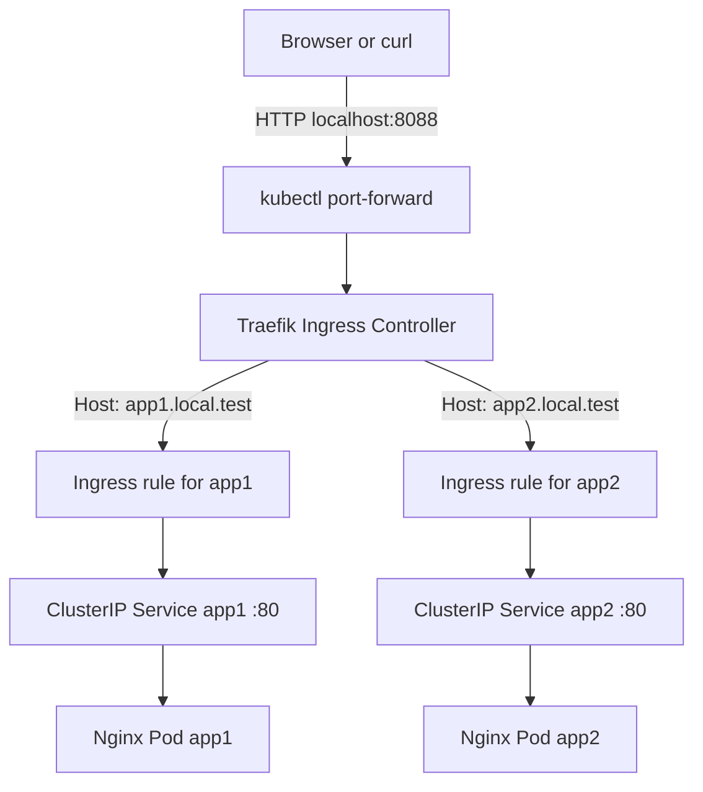
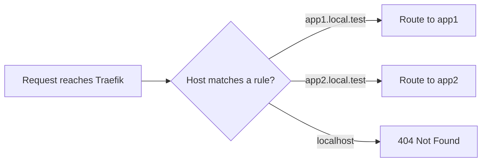
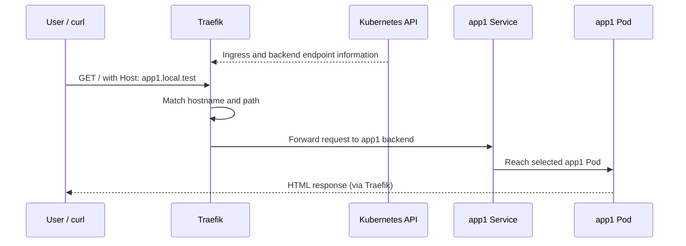

# Lab 02 — Basic Routing with Traefik and Kubernetes Ingress

> **Project:** Cloud-Native Traffic Gateway  
> **Environment:** Ubuntu VM → Podman → kind → Kubernetes  
> **Traefik:** v3.7.17 · **Helm chart:** 42.3.1 · **Kubernetes:** v1.37.0  
> **Status:** ✅ HTTP host-based routing verified for both applications

## 1. Goal

Route HTTP requests to **two independent Nginx applications** through a single Traefik entry point using the standard Kubernetes `Ingress` resource.

By the end of this lab, we can explain:

- How an **Ingress Controller** turns Kubernetes routing rules into working proxy configuration.
- The roles of **Ingress**, **Service**, **Pod**, and **HTTP Host header**.
- Why `curl -H 'Host: …'` succeeds while browsing to `localhost` can return **404**.
- How to inspect routing in Kubernetes and Traefik's dashboard.

## 2. Architecture



**Key point:** `kubectl port-forward` provides the local connection to Traefik. Traefik then uses the request's hostname to choose the backend Kubernetes Service.

## 3. Starting point

Traefik was already deployed in the `traefik` namespace, with its dashboard available through local port-forwarding from Lab 01.

Two Nginx-based web applications were already running in namespace **`web-lab`**:

| Resource | Namespace | Observed state |
|---|---|---|
| Deployment `app1` | `web-lab` | `1/1` available |
| Deployment `app2` | `web-lab` | `1/1` available |
| Service `app1` | `web-lab` | `ClusterIP`, port 80 |
| Service `app2` | `web-lab` | `ClusterIP`, port 80 |

We identified the namespace with:

```bash
kubectl get deployments,svc -A | grep -E 'NAMESPACE|app1|app2'
```

> **Why check the namespace?** A Kubernetes `Ingress` routes to Services in **its own namespace**. The empty `traefik-lab` namespace was not where these apps lived; creating the Ingress there would not connect it to `web-lab/app1` and `web-lab/app2`.

Read-only checks:

```bash
kubectl get deployments,pods,svc -n web-lab
kubectl get ingressclass
```

## 4. Create the routing configuration

Create `ingress.yaml` in the Traefik project directory:

```yaml
apiVersion: networking.k8s.io/v1
kind: Ingress
metadata:
  name: web-lab-ingress
  namespace: web-lab
spec:
  ingressClassName: traefik
  rules:
    - host: app1.local.test
      http:
        paths:
          - path: /
            pathType: Prefix
            backend:
              service:
                name: app1
                port:
                  number: 80
    - host: app2.local.test
      http:
        paths:
          - path: /
            pathType: Prefix
            backend:
              service:
                name: app2
                port:
                  number: 80
```

Apply it:

```bash
kubectl apply -f ingress.yaml
kubectl get ingress -n web-lab
kubectl describe ingress web-lab-ingress -n web-lab
```

### Understanding the YAML

| Field | Purpose |
|---|---|
| `kind: Ingress` | Declares HTTP routing rules using the standard Kubernetes API. |
| `metadata.namespace: web-lab` | Places the Ingress beside its target Services. |
| `ingressClassName: traefik` | Selects the Traefik controller. |
| `rules[].host` | Matches the incoming HTTP hostname. |
| `path: /`, `pathType: Prefix` | Matches URL paths beginning with `/`. |
| `backend.service.name` | Identifies the Kubernetes Service receiving traffic. |
| `backend.service.port.number: 80` | Uses Service port 80—not necessarily the Pod's container port. |

## 5. Make Traefik reachable from the Ubuntu VM

In a **separate terminal**:

```bash
kubectl port-forward -n traefik svc/traefik 8088:80
```

Leave this running while testing. This maps **Ubuntu localhost port 8088** to **Traefik Service port 80** through the Kubernetes API.

> **Why port-forward?** Our kind node runs as a Podman container. A Kubernetes `NodePort` is not necessarily reachable at `localhost` on the Ubuntu host without additional container port mappings. Port-forwarding lets us test Ingress behavior without changing cluster networking.

## 6. Verify host-based routing with curl

In another terminal:

```bash
curl -H 'Host: app1.local.test' http://localhost:8088/
curl -H 'Host: app2.local.test' http://localhost:8088/
```

### Actual observed results

**app1:**

```html
<h1>Hello from app1!</h1>
<p>Served by Nginx inside Kubernetes.</p>
```

**app2:**

```html
<h1>Hello from app2!</h1>
<p>Served by Nginx inside Kubernetes.</p>
```

✅ **Both tests passed.** This proves that Traefik selected different backends based on the requested hostname, and the apps were reachable through their Services.

## 7. Troubleshooting: browser shows 404 at localhost

We initially opened:

```text
http://localhost:8088/
```

The browser sends a hostname of `localhost`, but our Ingress only contains rules for `app1.local.test` and `app2.local.test`.



**Important:** This 404 is expected when no routing rule matches. It doesn't mean the Traefik Service or backends are broken.

### Optional: Enable hostname-based browser testing

On the **same machine where the browser is running**, add the following mappings to `/etc/hosts` (if the port-forward is bound to that machine's localhost):

```text
127.0.0.1 app1.local.test
127.0.0.1 app2.local.test
```

For example:

```bash
sudo nano /etc/hosts
```

Then visit:

- `http://app1.local.test:8088/`
- `http://app2.local.test:8088/`

These mappings change **hostname resolution**, not Traefik's routing configuration. Don't overwrite existing hosts-file entries. Remove these lines to undo the change.

> **Verification status:** Browser hostname access was proposed; successful `curl` responses were confirmed. Browser success has not yet been explicitly confirmed in this lab record.

## 8. Inspect the Traefik dashboard

In another terminal, if it isn't already running:

```bash
kubectl port-forward -n traefik deployment/traefik 9000:8080
```

Open:

```text
http://localhost:9000/dashboard/
```

Look under **HTTP → Routers** for routes associated with the two hostnames, then **HTTP → Services** for the backend configurations. Router and Service names are generated by Traefik and may include the `@kubernetes` provider suffix.

Compare the dashboard with Kubernetes objects:

```bash
kubectl get ingress -n web-lab
kubectl get ingress web-lab-ingress -n web-lab -o yaml
kubectl get endpointslices -n web-lab
```

> **Verification status:** Dashboard access was confirmed in Lab 01. Inspection of these particular routes in the dashboard was suggested but not explicitly confirmed.

## 9. What happened behind the scenes?



This is a **conceptual** illustration. Depending on Traefik's Kubernetes provider settings, Traefik may load-balance directly to Pod endpoints rather than sending packets to the Service's ClusterIP. The critical separation remains: Kubernetes declares the backend; Traefik performs proxy routing.

## 10. Verification checklist

- [x] Identify the correct application namespace (`web-lab`).
- [x] Confirm both Deployments are available and both Services expose port 80.
- [x] Create host-based Kubernetes Ingress rules for both Services.
- [x] Reach app1 through Traefik using the `Host` header.
- [x] Reach app2 through Traefik using the `Host` header.
- [x] Explain the unmatched-hostname `404` behavior.
- [ ] Verify both custom hostnames in the browser.
- [ ] Inspect the two routers and backend Services in the dashboard.

## 11. Cleanup / rollback

To remove **only this lab's Ingress resource**, while keeping Traefik and both Nginx applications:

```bash
kubectl delete ingress web-lab-ingress -n web-lab
```

To stop local testing, press `Ctrl+C` in each `kubectl port-forward` terminal. Remove the optional `/etc/hosts` entries if you added them.

**Do not** delete the `web-lab` namespace unless you also intend to delete its applications and Services.

## 12. Lessons learned

1. An `Ingress` defines rules; an Ingress controller such as **Traefik** implements them.
2. A Kubernetes `ClusterIP` Service can serve as an Ingress backend without being directly exposed to external clients.
3. **DNS resolution** determines the destination IP, while the **HTTP Host header** determines which host-based router matches.
4. A Traefik **404** can mean a request reached the proxy but matched no router.
5. `kubectl port-forward` is useful for local testing, especially with **kind + Podman**.
6. Checking namespaces before deploying resources prevents a common Kubernetes configuration mistake.

## Next lab — Advanced Routing

In **Lab 03**, we'll keep these two applications and explore **Traefik IngressRoute CRDs**, **path-based routing**, and **Middleware** (such as request redirects, authentication, and rate limiting).

---

**Related file:** `values.yaml` from Lab 01 (Traefik Helm deployment).  
**Suggested location:** `14-Web-Servers/02-traefic/docs/lab-02-basic-routing.md`
